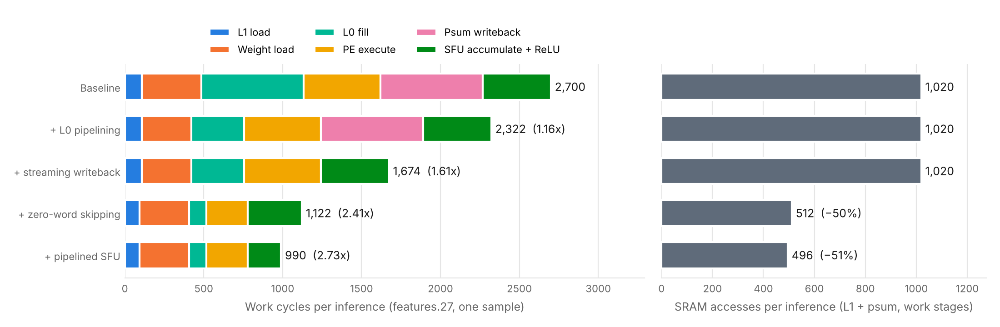

# Step 6 — alpha: sparsity-aware streaming dataflow

**On the trained `features.27` sample the alpha dataflow takes 990 work cycles per inference instead of 2,700 (2.73×), issues 69% fewer MAC slots and makes 51% fewer SRAM accesses, with bit-exact results in every regression case.** Mutation testing kills all 26 non-equivalent injected RTL faults; it also exposed a latent bug in the course FIFO (a write while full overwrote the oldest entry), now fixed.

## Motivation

Per inference the baseline occupies 20,736 MAC slots (9 kernel positions × 36 padded input words × 64 PEs). Only 9,216 (44.4%) contribute to a valid output, and only 1,559 (7.5%) also multiply two nonzero operands:

- every kernel position streams all 36 padded words, although only the 16 words of its 4×4 output window contribute;
- after ReLU 71.9% of the activations are zero (87.5% including padding); 20 of the 36 padded words are entirely zero, all of them padding.

## Design

All switches are optional; the default build and the Step 3/4 flow are unchanged. The controller is the testbench, as in the course template.

| Switch | Change | RTL impact |
|---|---|---|
| `--pipeline-l0` | SRAM reads overlap L0 writes, one word per cycle | none |
| `--stream-ofifo` | psums leave a 16-word OFIFO while the PEs run (`STREAM_OFIFO=1`); peak occupancy is 8 words | OFIFO 8,192 → 2,048 data bits |
| `--skip-zero` | L1 stores only nonzero words plus a 36-bit occupancy bitmap. The controller reads the bitmap back from L1 and issues, per kernel position, only the nonzero words of its valid output window. Psums go to a compact (kernel, output) map, the SFU reads only the psums that exist, and a kernel position whose window is all zero is skipped, weight load included. | `xmem_read_data` port on `core`; corelet unchanged |
| `--pipeline-sfu` | the next psum read overlaps the current SFU add; ReLU follows the stored sum without a reload. Both write-backs remain. | none |
| `--operand-isolation` | the PE keeps the last nonzero activation at the multiplier and bypasses the product for zeros | `mac_tile` variant under `ifdef`; not adopted |

In a full network the previous layer's ReLU write-back can emit the bitmap with one OR reduction per word. A hardware controller needs a prefix count over the bitmap to form compact L1 addresses.

## Results

| Configuration (cumulative) | Work cycles | Speedup | MAC slots | SRAM accesses | Toggles excl. OFIFO (k) | OFIFO toggles (k) |
|---|---:|---:|---:|---:|---:|---:|
| Baseline | 2,700 | 1.00× | 20,736 | 1,020 | 1,615 | 2,121 |
| + L0 pipelining | 2,322 | 1.16× | 20,736 | 1,020 | 1,611 | 2,121 |
| + streaming writeback | 1,674 | 1.61× | 20,736 | 1,020 | 1,611 | 40* |
| + zero-word skipping | 1,122 | 2.41× | 6,400 | 512 | 893 | 17* |
| **+ pipelined SFU (alpha)** | **990** | **2.73×** | **6,400** | **496** | **883** | 17* |
| + operand isolation (not adopted) | 990 | 2.73× | 6,400 | 496 | 905 | 17* |

\* Behavioural 16-word OFIFO; not comparable with the course OFIFO in the first two rows (see Energy).



<details>
<summary>Cycles by stage (table view of the figure)</summary>

| Configuration | L1 load | Weight load | L0 fill | PE execute | Psum writeback | SFU accumulate + ReLU |
|---|---:|---:|---:|---:|---:|---:|
| Baseline | 108 | 378 | 648 | 486 | 648 | 432 |
| + L0 pipelining | 108 | 315 | 333 | 486 | 648 | 432 |
| + streaming writeback | 108 | 315 | 333 | 486 | 0 | 432 |
| + zero-word skipping | 92 | 315 | 109 | 262 | 0 | 344 |
| + pipelined SFU | 92 | 315 | 109 | 262 | 0 | 212 |

</details>

- **Where the cycles go.** L0 pipelining halves the fill; streaming writeback hides all 648 write-back cycles under execution; zero-word skipping cuts issued words from 324 to 100 and SFU reads from 144 to 100; the pipelined SFU removes the ReLU reload. Weight loading (315 cycles, 32% of the alpha total) is now the largest stage.
- **Synthetic sparsity** (`sparse_words`: 6×6 input, 50% zero words, 70% zero lanes): 4,528 → 1,272 cycles (3.56×); issued words 576 → 146; SRAM accesses 1,792 → 678.
- **All-zero input** (`zero_input`): 2,700 → 172 cycles. All nine kernel passes are skipped; the zero outputs are still written back and checked.
- **Other images.** Every interior word of the Step 1 sample has a nonzero channel, so word skipping removes only padding here and 990 cycles is the worst case for this layer shape; the dense `signed_limits` input also takes 990. Any other image therefore needs at most 990 cycles (at least 2.73×), and fewer when whole pixels are zero.
- **What remains.** The alpha keeps all 1,559 useful products in 6,400 issued slots (24%). The other slots hold zero lanes inside nonzero words, which word-level skipping cannot remove.
- **Accounting.** Work cycles are the testbench-controller cycles of stages 1–7, excluding verification readback (stage 50) and the reset interval between kernel positions. Stages 6–7 still contain a one-cycle read-back check of each written output (32 cycles in every row). SRAM accesses and toggles exclude all read-back checks.

## Energy

Energy per inference is E = P·N/f. Step 5 measured P = 373.79 mW at 100 MHz with vectorless activity (core dynamic 211.54 mW, static 119.73 mW, I/O 42.52 mW), so the baseline costs 10.09 µJ.

- **Alpha estimate (conditional).** If the alpha corelet drew the baseline's 373.79 mW, an inference would cost 3.70 µJ (2.73× less). This is not a bound: the alpha changes the output FIFO (2,048 instead of 8,192 data bits; the 8,192 are about two thirds of the 12,098 registers in the baseline fit) and the switching per cycle. Frequency, resources and power are compared once both versions are fitted with the same settings; until then the evidence is cycles and SRAM accesses.
- **Activity.** SRAM accesses fall 51% (1,020 → 496; psum SRAM writes 356 → 132). Corelet bit toggles outside the OFIFO fall 45% (1.61 M → 0.88 M); these blocks use identical RTL in every row. Both are simulation counts, a first-order proxy for dynamic energy; Power Analyzer turns them into power once it is given a gate-level VCD (pending).
- **OFIFO toggles are not comparable across implementations.** The course OFIFO is a register file per lane with a 64:1 multiplexer tree that switches on every pointer increment: 2.12 M toggles, 57% of all baseline corelet toggles. The streaming FIFO is written behaviourally, so its storage does not appear in the VCD and its count is understated. The Quartus fit is the fair comparison.
- **Operand isolation is not adopted.** Holding the last nonzero activation at the multiplier removes 20% of multiplier-input toggles but adds 4.4% to the array's toggles through the extra registers and output multiplexer (+2.6% overall), and the extra registers also add clock load. It would pay off only if each multiplier-input flip caused about 12 internal flips, which we do not expect from a 4-bit multiplier; a gate-level run can settle it.

## Verification

- **Regression.** Every configuration passes 8 cases × 2 jobs bit-exactly against the integer golden: the Step 1 sample, signed limits, a rectangular input, a 1×1 kernel, 64-word FIFO capacity, a single word, `sparse_words` and `zero_input`. The X/Z, uninitialized-data and completeness checks from Step 4 (#3) apply in every mode; the completeness check expects one comparison per issued psum plus four per output. The testbench prints its issued words, SFU reads, skipped passes and SRAM accesses per job, and `run.py` fails unless they equal an independent count from the input data.
- **Mutation testing** (`mutate.py`). 27 single-point faults across the MAC, PE, row, array, L0, both OFIFOs, FIFO64, SFU, corelet and core are injected one at a time. A mutant is killed when the regression fails in the baseline or the alpha mode. This is the negative control that Step 4 lists as not run.

| Round | Mutants | Killed | Survived |
|---|---:|---:|---|
| 1 | 26 | 18 | M11, M13–M14, M16–M19: back-pressure, underflow and FIFO-full paths that full-layer runs never reach, and an OFIFO read-timing fault hidden by the testbench handshake; M12 |
| 2 | 27 | 26 | M12 only, an equivalent mutant |

Round 2 adds a directed FIFO/L0/OFIFO unit test (`Step3/fifo_tb.v`), which runs with every regression. It exposed a real defect: the course `fifo_depth64` stops its write pointer when full but still writes the data, overwriting the oldest entry. The fix gates the data write with `!full` (one line, also in the Part 2 copy). Full-layer runs never write a full FIFO, so no earlier result changes; mutant M27 restores the original line and is killed. M12 reverses the L0 lane order; weights and activations share those lanes, so it only permutes the input-channel sum. Per-mutant outcomes and the first failing check: [results/mutation.json](results/mutation.json).

## Pending items

| Item | Owner | Detail |
|---|---|---|
| Quartus fits | Step 5 | Refit the baseline with the current sources (FIFO fix) and fit a `STREAM_OFIFO=1` revision; report LEs, registers, Fmax and power at the same settings |
| Gate-level activity power | Step 5 | EDA Netlist Writer → `corelet.vo`; simulate it under `core_tb` in ModelSim–Intel FPGA with the Cyclone IV atom libraries, dump `core_tb.dut.datapath` to a VCD and load it in Power Analyzer, for the baseline and the alpha |
| More real samples | Step 1 environment | `train.py --evaluate ... --sample-index N` exports a sample; `python Step6/samples.py runs/sample_*/vectors` runs both modes on each |

## Reproduce

```text
python Step3/run.py --regress --pipeline-l0 --stream-ofifo --skip-zero --pipeline-sfu
python Step6/ablation.py      # results/ablation.json and ablation.png; --replot only redraws
python Step6/mutate.py        # results/mutation.json; about 10 min
```

Add `--sim vivado --vivado-bin <dir>` to `run.py` or `mutate.py` to use Vivado; `ablation.py` needs Icarus Verilog because it reads every corelet net from the VCD. The numbers above come from Icarus Verilog 11.0, which gives the same cycle counts as Vivado for the baseline and streaming modes.
